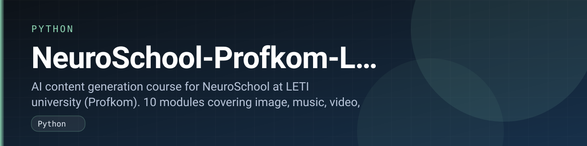

# NeuroSchool-Profkom-LETI

### AI content generation course for NeuroSchool at LETI university (Profkom). 10 modules covering image, music, video, storytelling, design, gaming, AI agents, social media, education, ethics.

---

Добро пожаловать в репозиторий **"Нейрошкола от профкома ЛЭТИ"** — образовательного курса, посвящённого применению искусственного интеллекта в создании контента и других областях! Этот репозиторий содержит материалы, ресурсы и ссылки для 10-недельного курса, который стартует 3 марта 2025 года. Здесь вы найдёте всё необходимое для изучения современных ИИ-инструментов и их практического применения.

## О курсе

"Нейрошкола" — это серия лекций и мастер-классов, организованных профкомом ЛЭТИ, чтобы познакомить студентов с возможностями ИИ. Каждая неделя посвящена одной теме, от генерации изображений до этических вопросов. В каждой папке вы найдёте:
- Описание темы.
- Ссылки на инструменты.
- Учебные материалы.

## Темы курса

1. [Генерация изображений с помощью нейросетей](NeuroSchool-Profkom-LETI/Topic1-ImageGeneration)
2. [Композиция музыки с использованием ИИ](NeuroSchool-Profkom-LETI/Topic2-MusicComposition)
3. [ИИ в видеопроизводстве](NeuroSchool-Profkom-LETI/Topic3-VideoProduction)
4. [Нейросети для текста и сторителлинга](NeuroSchool-Profkom-LETI/Topic4-TextStorytelling)
5. [Дизайн и искусство с инструментами ИИ](NeuroSchool-Profkom-LETI/Topic5-DesignArt)
6. [ИИ в играх и интерактивных медиа](NeuroSchool-Profkom-LETI/Topic6-GamingInteractive)
7. [ИИ-агенты](NeuroSchool-Profkom-LETI/Topic7-AIAgents)
8. [ИИ для контента в социальных сетях](NeuroSchool-Profkom-LETI/Topic8-SocialMedia)
9. [Создание образовательного контента с ИИ](NeuroSchool-Profkom-LETI/Topic9-EducationalContent)
10. [Этические аспекты применения ИИ](NeuroSchool-Profkom-LETI/Topic10-Ethics)

## Как использовать

- Перейдите в папку нужной темы.
- Ознакомьтесь с `README.md` для каждой недели.
- Используйте ссылки для изучения инструментов и выполнения домашних заданий.

## Лицензия

Проект распространяется под лицензией Apache 2.0. См. файл [LICENSE](LICENSE).

## Контакты

Вопросы? Пишите в Telegram-группу курса.

*Создано с помощью ИИ для ИИ-энтузиастов!*
